# Praktikum Pemrograman Web 8 — PHP & MySQL (CRUD Data Barang)

Repository ini berisi hasil praktikum **Pemrograman Web: PHP & MySQL** mengenai pembuatan database relasional serta implementasi aplikasi web **CRUD (*Create, Read, Update, Delete*)** berbasis PHP prosedural (`mysqli`) dengan studi kasus manajemen **Data Barang**.

## Identitas Mahasiswa

* **Nama:** Angga Qomaruzzaman
* **NIM:** 312510158
* **Kelas:** I253C
* **Program Studi:** Teknik Informatika — Universitas Pelita Bangsa
* **Repository GitHub:** <https://github.com/ZiQax/Lab8Web>

## Lingkungan Pengembangan

* **Local Server Stack:** Laragon (Apache 2.4.69 & MySQL 8.4.3)
* **Database Client:** phpMyAdmin & MySQL Command Line
* **Direktori Proyek:** `C:\laragon\www\htdocs\Lab8Web\lab8_php_database`

## Struktur Folder & File Proyek

```text
Lab8Web/
├── img/
│   ├── image-1.png
│   ├── image-2.png
│   ├── image-3.png
│   ├── image-4.png
│   ├── image-5.png
│   ├── image-6.png
│   ├── image-7.png
│   ├── image-8.png
│   ├── image-9.png
│   ├── image-10.png
│   ├── image-11.png
│   ├── image-12.png
│   └── image-13.png
├── lab8_php_database/
│   ├── hapus.php
│   ├── index.php
│   ├── koneksi.php
│   ├── style.css
│   ├── tambah.php
│   └── ubah.php
└── README.md
```

| Nama File / Folder | Keterangan |
| :--- | :--- |
| `img/` | Folder penyimpanan seluruh tangkapan layar (*screenshot*) dokumentasi praktikum (`image-1.png` – `image-13.png`). |
| `lab8_php_database/koneksi.php` | Konfigurasi koneksi PHP ke database MySQL (`latihan1`) menggunakan `mysqli_connect()`. |
| `lab8_php_database/index.php` | Halaman utama untuk menampilkan daftar seluruh data barang dari database (**Read**). |
| `lab8_php_database/tambah.php` | Form dan logika penambahan data barang baru beserta unggah (*upload*) file gambar (**Create**). |
| `lab8_php_database/ubah.php` | Form dan logika pembaruan data barang berdasarkan `id_barang` (**Update**). |
| `lab8_php_database/hapus.php` | Skrip penghapusan baris data barang dari database berdasarkan parameter `id` (**Delete**). |
| `lab8_php_database/style.css` | Stylesheet CSS untuk tata letak tabel data barang dan formulir input/ubah barang. |
| `README.md` | Dokumentasi lengkap laporan hasil praktikum. |

---

## Langkah-Langkah Praktikum & Dokumentasi

### 1. Mengakses MySQL Server & Client

Menjalankan layanan **Apache 2.4.69** dan **MySQL 8.4.3** pada Laragon, lalu mengakses MySQL Client melalui **phpMyAdmin** maupun terminal MySQL.

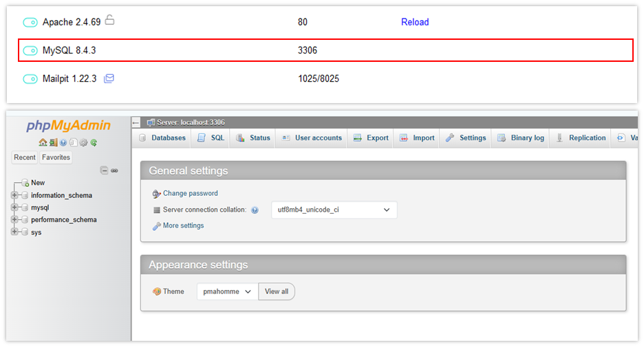

---

### 2. Membuat Database (`latihan1`)

Membuat database baru dengan nama `latihan1` sebagai wadah penyimpanan tabel studi kasus data barang:

```sql
CREATE DATABASE latihan1;
```

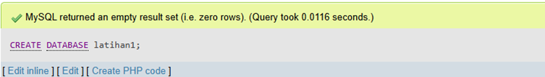

---

### 3. Membuat Tabel (`data_barang`)

Membuat tabel `data_barang` di dalam database `latihan1` dengan struktur kolom `id_barang` (*Primary Key, Auto Increment*), `kategori`, `nama`, `gambar`, `harga_beli`, `harga_jual`, dan `stok`:

```sql
CREATE TABLE data_barang (
    id_barang int(10) auto_increment Primary Key,
    kategori varchar(30),
    nama varchar(30),
    gambar varchar(100),
    harga_beli decimal(10,0),
    harga_jual decimal(10,0),
    stok int(4)
);
```

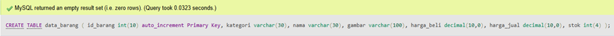

---

### 4. Menambahkan Data Awal Barang

Memasukkan 3 data awal produk elektronik (`HP Samsung Android`, `HP Xiaomi Android`, dan `HP OPPO Android`) ke dalam tabel `data_barang` dan memverifikasinya menggunakan query `SELECT * FROM data_barang;`:

```sql
USE latihan1;
INSERT INTO data_barang (kategori, nama, gambar, harga_beli, harga_jual, stok)
VALUES
    ('Elektronik', 'HP Samsung Android', 'hp_samsung.jpg', 2000000, 2400000, 5),
    ('Elektronik', 'HP Xiaomi Android', 'hp_xiaomi.jpg', 1000000, 1400000, 5),
    ('Elektronik', 'HP OPPO Android', 'hp_oppo.jpg', 1800000, 2300000, 5);
```

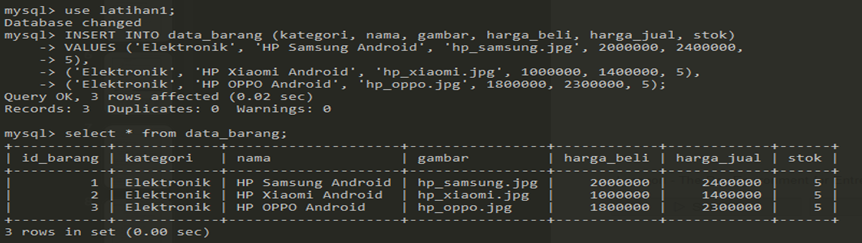

---

### 5. Membuat Folder Proyek pada Docroot Web Server

Membuat folder proyek dengan nama `lab8_php_database` di dalam direktori root web server (`C:\laragon\www\htdocs\`).

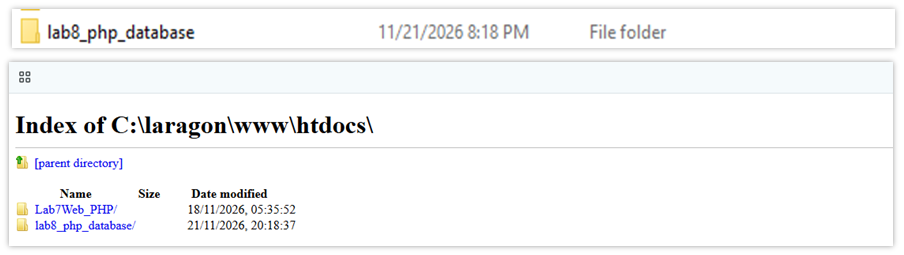

---

### 6. Membuat File Koneksi Database (`koneksi.php`)

Membuat file `koneksi.php` untuk menghubungkan aplikasi PHP dengan database `latihan1` pada server `localhost`, kemudian mengujinya melalui browser hingga muncul pesan **"Koneksi berhasil"**.

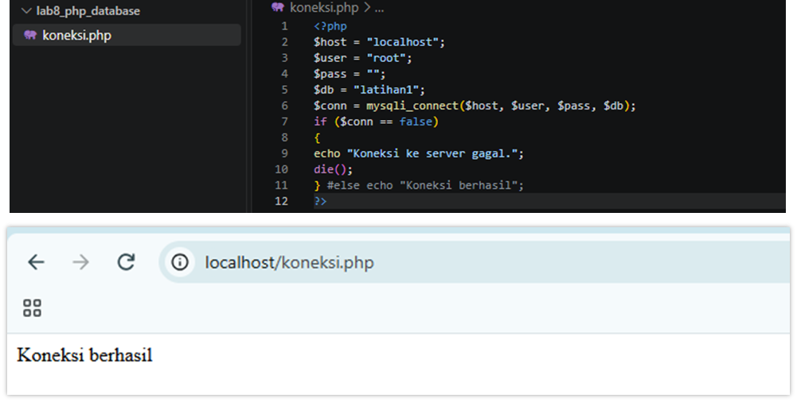

---

### 7. Menampilkan Data — Read (`index.php` & `style.css`)

Membuat file `index.php` yang menjalankan query `SELECT * FROM data_barang` dan menampilkannya dalam bentuk tabel HTML yang telah diatur tampilannya menggunakan `style.css`.

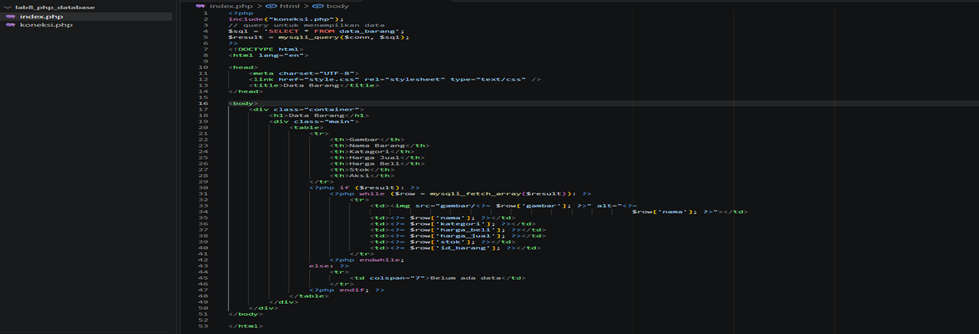
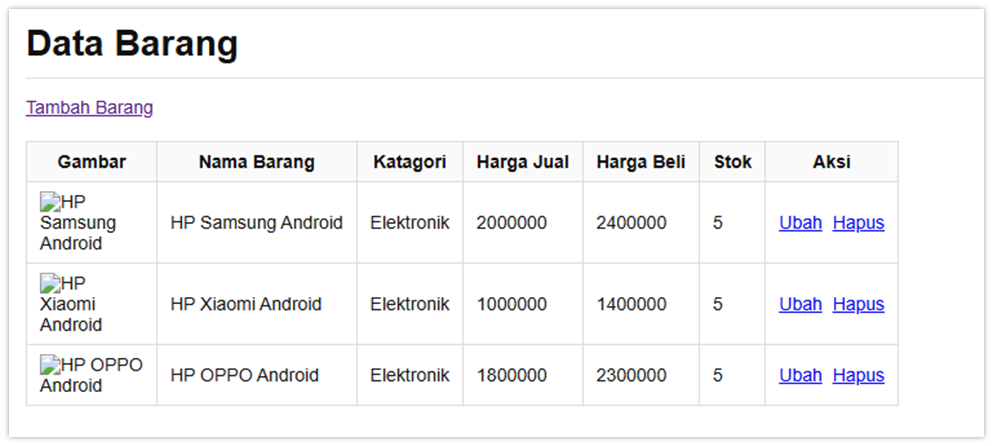

---

### 8. Menambah Data — Create (`tambah.php`)

Membuat file `tambah.php` yang berisi formulir input data barang dengan atribut `enctype="multipart/form-data"` untuk menangani pengunggahan gambar produk ke folder `gambar/` sekaligus menyimpan record baru ke tabel `data_barang`.

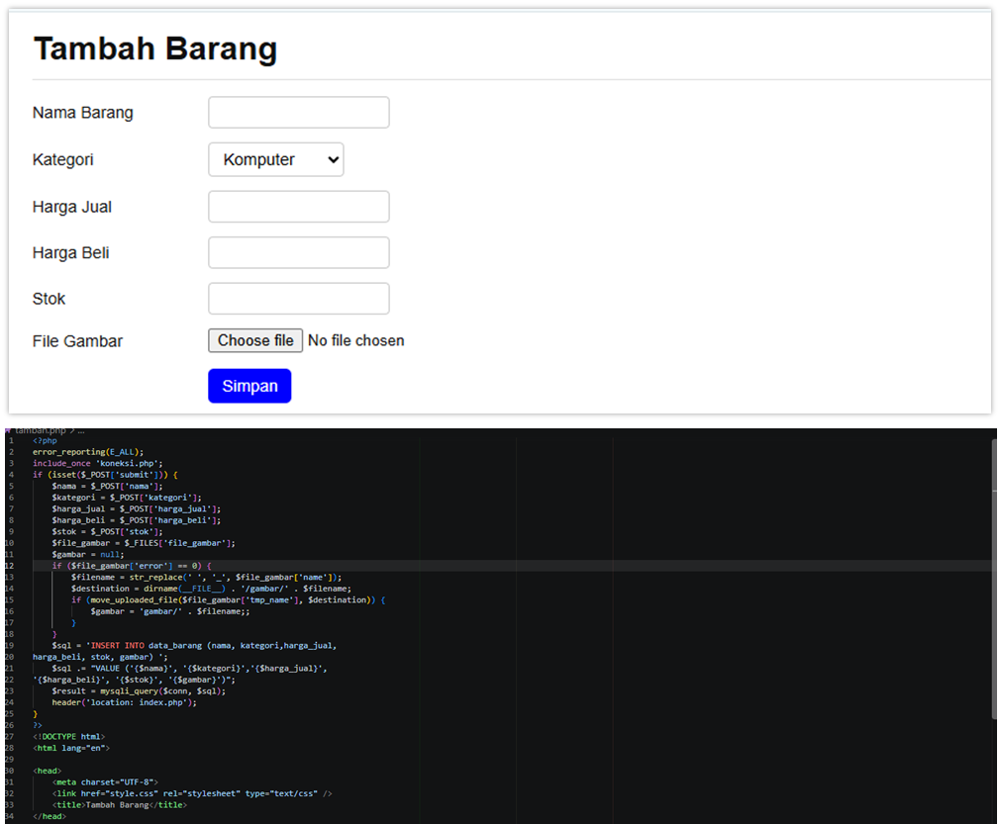
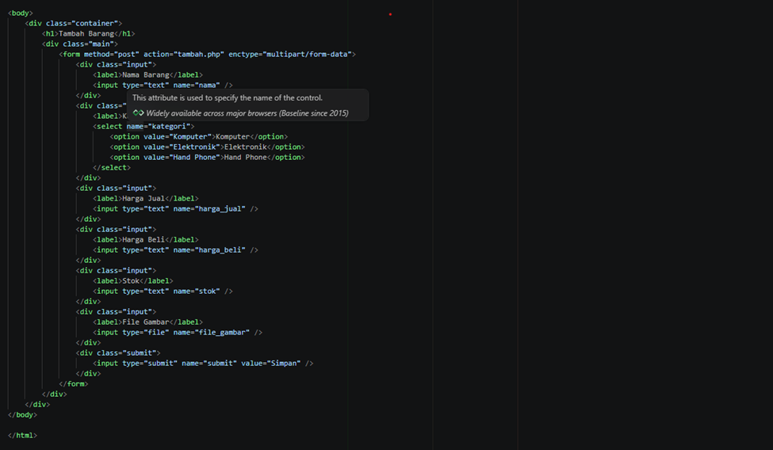

---

### 9. Mengubah Data — Update (`ubah.php`)

Membuat file `ubah.php` untuk mengambil data barang berdasarkan `id_barang` melalui parameter URL (`$_GET['id']`), menampilkannya kembali pada form edit (termasuk status `selected` pada dropdown kategori dan `input type="hidden"` untuk `id`), lalu menyimpan pembaruan dengan query `UPDATE`.

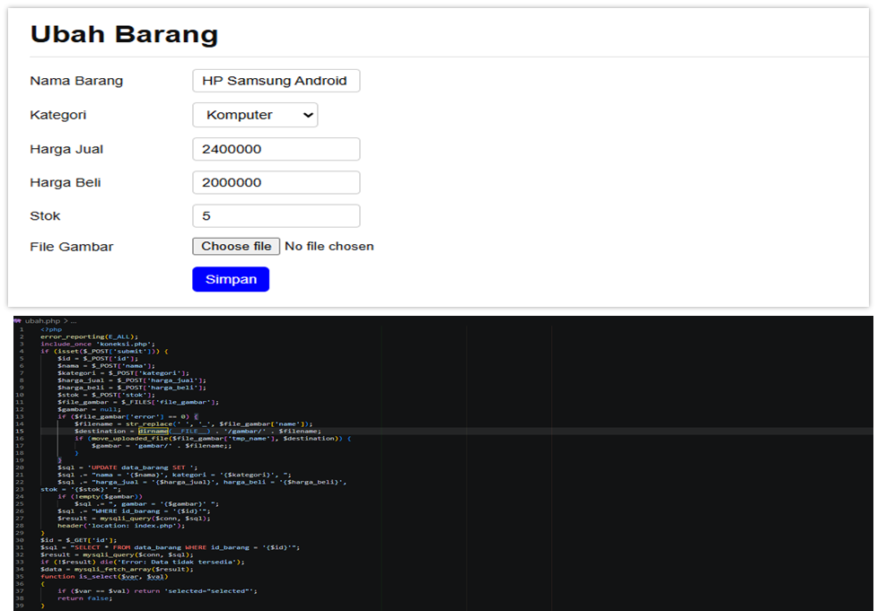
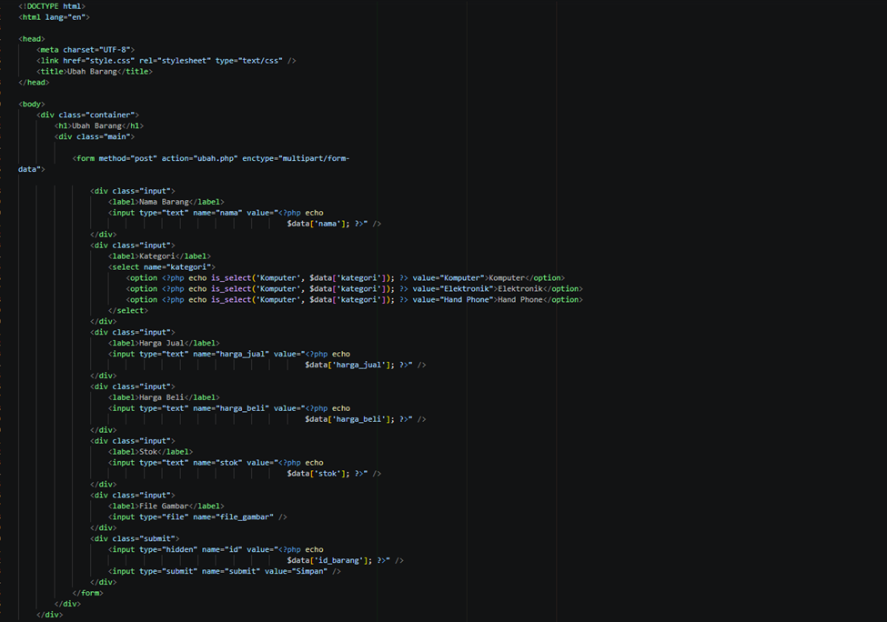
---

### 10. Menghapus Data — Delete (`hapus.php`)

Membuat file `hapus.php` untuk mengeksekusi query `DELETE FROM data_barang WHERE id_barang = '{$id}'` dan mengarahkan pengguna kembali ke `index.php` setelah data terhapus.

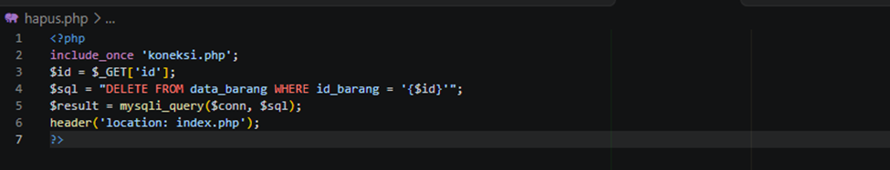
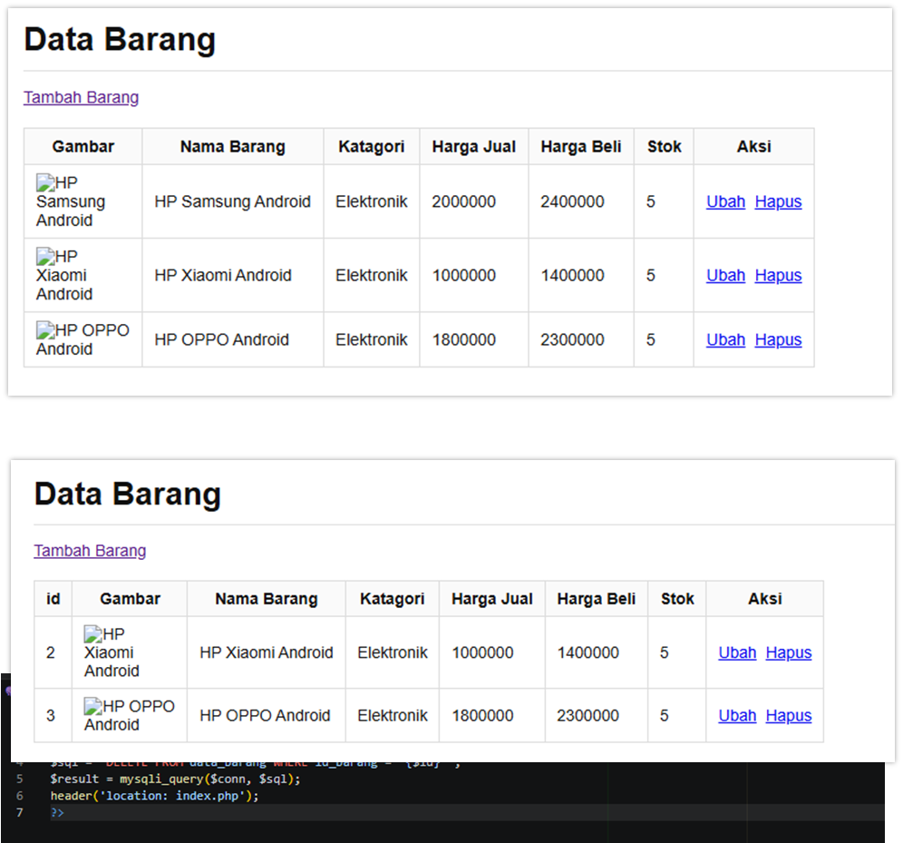

---

### 11. Manajemen Repository GitHub (`Lab8Web`)

Membuat repository baru bernama `Lab8Web` di GitHub, melakukan `git clone` ke dalam direktori `htdocs`, memindahkan folder kerja `lab8_php_database` ke dalamnya, lalu melakukan `git add .`, `git commit`, dan `git push origin main`.

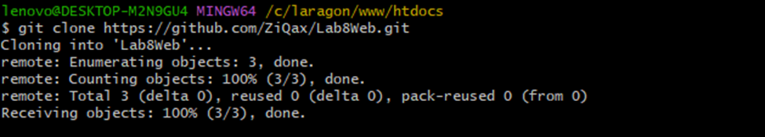

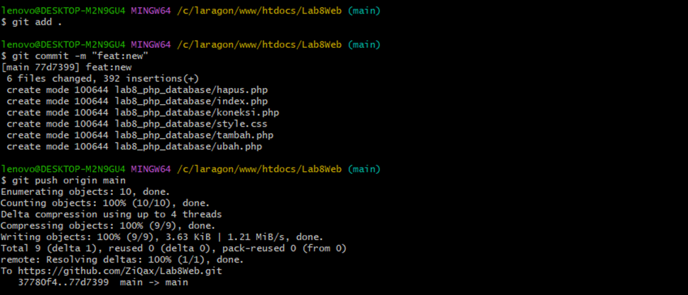

---

## Catatan Troubleshooting Selama Praktikum

1. **`Warning: Undefined array key "id"` pada `ubah.php`:**
   * **Penyebab:** Halaman `ubah.php` diakses tanpa parameter `?id=...` di URL, atau eksekusi PHP terus berlanjut ke baris `$_GET['id']` setelah tombol **Simpan** (`POST`) ditekan karena tidak ada perintah `exit;` setelah `header('location: index.php');`.
   * **Solusi:** Mengarahkan tautan aksi di `index.php` ke `ubah.php?id=<?= $row['id_barang']; ?>`, menambahkan `exit;` setelah `header()`, serta menggunakan pengecekan `$id = $_GET['id'] ?? null;`.
2. **Penyesuaian Jumlah Kolom Tabel pada `index.php`:**
   * Menghapus sel `<td><?= $row['id_barang']; ?></td>` yang berlebih di dalam perulangan `while` agar jumlah kolom data (`<td>`) selaras dengan 7 header kolom (`<th>`) yang didefinisikan.

## Cara Menjalankan Proyek

1. Pastikan **Laragon** (atau XAMPP) sudah terinstal dan layanan **Apache** serta **MySQL** dalam keadaan aktif.
2. Buat database `latihan1` dan tabel `data_barang` melalui phpMyAdmin atau MySQL CLI sesuai struktur SQL pada bagian di atas.
3. Clone repository ini ke dalam direktori root web server (`C:\laragon\www\htdocs\`):
   ```bash
   git clone https://github.com/ZiQax/Lab8Web.git
   ```
4. Pastikan folder `gambar/` tersedia di dalam direktori `lab8_php_database/` untuk menyimpan file gambar yang diunggah.
5. Buka browser dan akses melalui alamat:
   ```text
   http://localhost/htdocs/Lab8Web/lab8_php_database/index.php
   ```